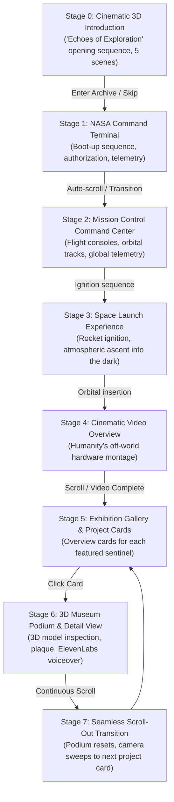

# 🌌 Novochronos: Project Architecture & User Journey Overview
> **2026 NASA Space Apps Challenge**  
> **Challenge:** *Abandoned but not Forgotten: Storytelling about NASA's Discarded Equipment on the Moon and Mars*  
> **Repository:** [https://github.com/LordScientist/Novochronos](https://github.com/LordScientist/Novochronos)

---

## 🧭 Executive Vision

**Novochronos** is an experiential, story-driven web application that transports school-age space enthusiasts, educators, and casual learners from a NASA Mission Control command terminal into the silent resting places of humanity's off-world robotic explorers.

Rather than presenting information as dry historical textbooks, the application is structured as a **seamless cinematic sweep** from ground telemetry to rocket liftoff, into an overarching mission video montage, and finally descending onto **tactile 3D exhibition podiums** where dormant machines are uncovered, inspected, and brought back to life through voice-acted audio stories.

---

## 🎬 The 8-Stage Cinematic User Journey



---

### Detailed Stage Breakdown

### Stage 0: Cinematic 3D Introduction (Echoes of Exploration)
* **Visual Direction:** Circular aerospace exhibition architecture, deep space environment, authentic NASA exploration models, documentary-grade camera choreography.
* **The 5-Scene Sequence:**
  1. **Scene 1 (Awakening):** Pitch-black cosmic void; subtle stars and monumental circular architectural ribs emerge from darkness as the camera glides into the exhibition hall.
  2. **Scene 2 (The Eight Sentinels):** Sequential dramatic mechanical spotlight reveals focusing on Opportunity's solar panels & mast, Ingenuity's coaxial rotors, Apollo 11's golden descent stage & ALSEP laser prism, InSight's solar fans & seismometer, Apollo 15's piano-wire wheels & umbrella dish, Sojourner's micro-chassis, Pioneer 10's parabolic dish & gold plaque, and Surveyor 3's soil claw.
  3. **Scene 3 (Grand Exhibition):** Panoramic 360° orbital sweep displaying all eight machines arranged around the circular amphitheater.
  4. **Scene 4 (Planetary Reveal):** Transition to a 3D Martian landscape with geological depth, rocks, and an explicit **Historical Staging Notice** clarifying artifact planetary homes (Moon, Mars, Deep Space).
  5. **Scene 5 (Title Reveal & Call-to-Action):** Hero composition with monumental **NOVOCHRONOS: ECHOES OF EXPLORATION** branding and primary **ENTER THE ARCHIVE** button (plus Skip Intro and Replay controls).

---

### Stage 1: NASA Command Interface (The Boot Sequence)
* **Visual Aesthetic:** Minimalist retro-futuristic aerospace terminal (`#030712` background, CRT scanline glow, monospace terminal font).
* **Experience:** As the user arrives, the interface initiates an authentic NASA deep-space telemetry handshake:
  ```text
  [NOVOCHRONOS TELEMETRY INITIALIZED]
  > CONNECTING TO DEEP SPACE NETWORK (DSN)...
  > RETRIEVING OFF-WORLD ARTIFACT REGISTRY...
  > AUTHENTICATION VERIFIED: NASA SCIENCE MISSION DIRECTORATE
  ```
* **Transition:** Automatically scrolls / sweeps down into the Command Center once the boot sequence completes (or via instant "Skip to Command" shortcut).

---

### Stage 2: Mission Control Command Center
* **Visual Aesthetic:** The iconic Mission Control room layout with glowing orbital tracking maps, telemetry telemetry dials, mission clocks, and status monitors.
* **Header:** Features the official **NASA Insignia ("Meatball" logo)**, live mission elapsed clocks, and celestial body jump links (Moon / Mars / Deep Space).
* **Role:** Establishes context: humanity has hardware resting silently across the solar system that paved the way for modern exploration.

---

### Stage 3: The Space Launch Scene
* **Visual Aesthetic:** 3D Canvas / WebGL atmospheric ascent sequence.
* **Experience:** 
  * Countdown sequence reaches `T-0`.
  * Rocket ignition: plumes of illuminated vapor, dynamic camera shake, and ground-level perspective.
  * The rocket ascends through cloud layers and pierces into the dark vacuum of space, smoothly transitioning from Earth-bound coordinates into interplanetary space.

---

### Stage 4: Cinematic Video Overview
* **Media Asset:** An evocative, high-definition video montage playing embedded with custom playback controls.
* **Narrative Focus:** Introduces school-age visitors to the mystery of the "Silent Sentinels": why rovers, descent stages, and probes were left behind, and how each one solved a vital question for humanity.
* **Transition Trigger:** Seamlessly advances to the first exhibition project on scroll or when the video completes playback.

---

### Stage 5: Project Picture Cards (Exhibition Gallery Bay)
* **Layout:** A clean, curated exhibition grid / carousel showcasing our 8 featured sentinels.
* **Card Anatomy:**
  * High-resolution archival mission photography.
  * Celestial status pill (e.g., `MARS` / `PERMANENT MONUMENT` / `DORMANT`).
  * Target Coordinates & Landing Site Name.
  * One-sentence evocative teaser of the machine's legacy.
* **Interaction:** Clicking any project card triggers a smooth camera fly-in that expands the card into the full **Stage 6: 3D Museum Podium**.

---

### Stage 6: The 3D Museum Podium & Deep-Dive Detail View
* **The Centerpiece:** The physical 3D stasis plinth elevates and uncovers the machine.
* **Interactive 3D Model Canvas:**
  * Visitors can click and drag to orbit 360° around the authentic 3D model (e.g. rotating Opportunity's camera mast, spinning Ingenuity's blades, inspecting the Apollo retroreflector).
  * Three-point museum gallery spotlights cast dramatic realistic shadows.
* **The Curated Story Plaque (`MuseumPlaque.tsx`):**
  * **Tab 1: The Story** (Narrative text written from an inspiring, character-driven perspective, explaining why it was left behind).
  * **Tab 2: Hardware & Science** (Breakthrough discoveries and instrument cards).
  * **Tab 3: Young Explorers Dossier** ("Did You Know?" fun cosmic facts for kids and launch/landing timestamps).
* **Voiceover Audio Guide (`AudioNarrator.tsx`):**
  * Prominent **Play / Pause** button that plays the dedicated character voiceover track (generated via ElevenLabs by Justice & Ishmael).
  * Scrub progress bar, playback speed toggles (`1x`, `1.25x`, `1.5x`), and synchronized read-along script modal.

---

### Stage 7: Seamless Continuous Scroll-Out Transition
* **The Innovation:** Even while the visitor is reading or exploring inside the detail view, scrolling the mouse wheel or touching the trackpad initiates a cinematic exit:
  * The current 3D podium lowers / stasis field re-engages.
  * The camera smoothly sweeps across the cosmic void (using our extracted `cubic-bezier(0.76, 0, 0.24, 1)` easing curve).
  * The next project picture card / podium glides into focus without page reloads or jarring breaks.
* **Loop Continuity:** Continues seamlessly across all 8 featured sentinels.

---

## 🛰️ The 8 Featured Sentinels in the Showcase

1. **Opportunity Rover (MER-B / "Oppy")**: Mars (Perseverance Valley, Endeavour Crater)
2. **Ingenuity Mars Helicopter ("Ginny")**: Mars (Airfield Valinor Hills, Jezero Crater)
3. **Apollo 11 Lunar Module Descent Stage & ALSEP**: Moon (Sea of Tranquility)
4. **InSight Geophysical Lander**: Mars (Elysium Planitia)
5. **Apollo 15 Lunar Roving Vehicle (LRV-1)**: Moon (Hadley Rille)
6. **Sojourner Rover & Mars Pathfinder**: Mars (Ares Vallis)
7. **Pioneer 10 Deep Space Probe**: Deep Space (Aldebaran trajectory)
8. **Surveyor 3 Robot Scout**: Moon (Ocean of Storms)

---

## 👥 Team Workstream Alignment

* **Roland (3D Motion Lead):** Stages 3 (Launch scene), Stage 6 (Podium 3D models, stasis shroud dissolve, spotlights), and Stage 7 (Camera transitions).
* **Justice (Voice Lead):** Stage 6 audio production (ElevenLabs character voices for all 8 sentinels, audio mastering, foley).
* **Joseph (UI/UX Lead):** Stage 1 (Command terminal), Stage 2 (Mission Control dashboard), Stage 5 (Project cards), and Stage 6 (Placard tabs).
* **Ishmael (Voice/Frontend Co-Lead):** Stage 4 (Video overview integration), Stage 6 (Audio player HUD & read-along transcript sync), and Stage 7 (Scroll physics).
